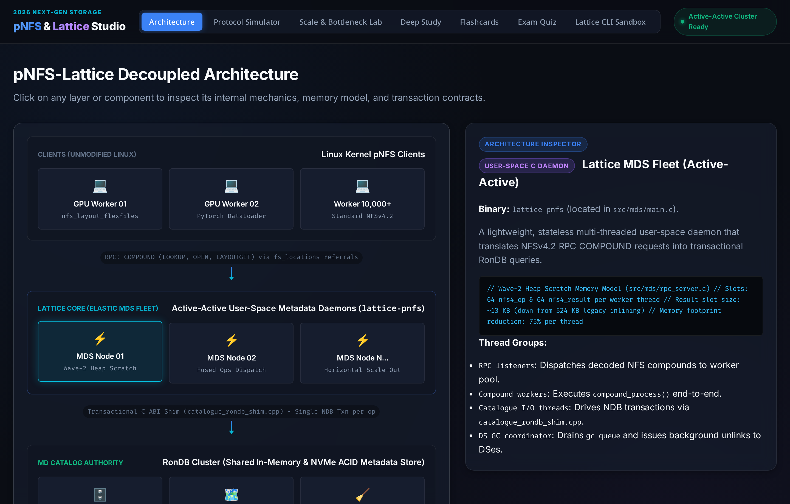
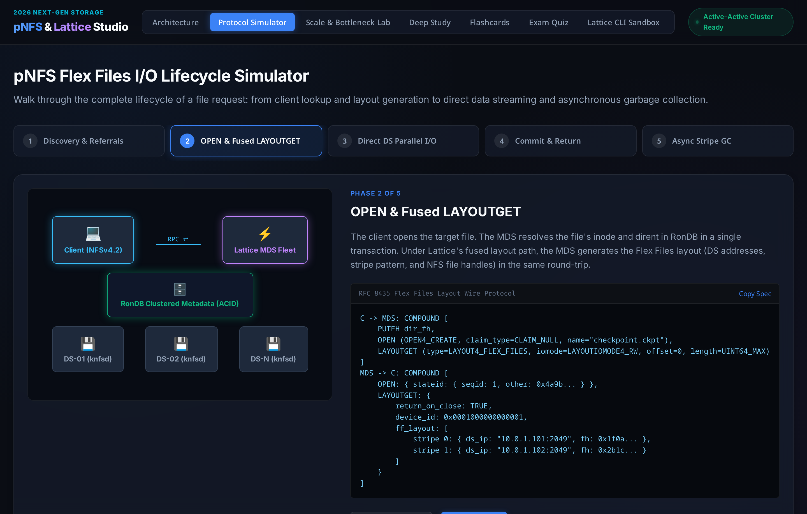
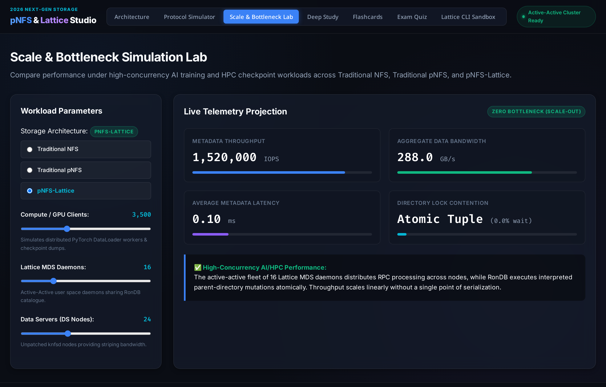
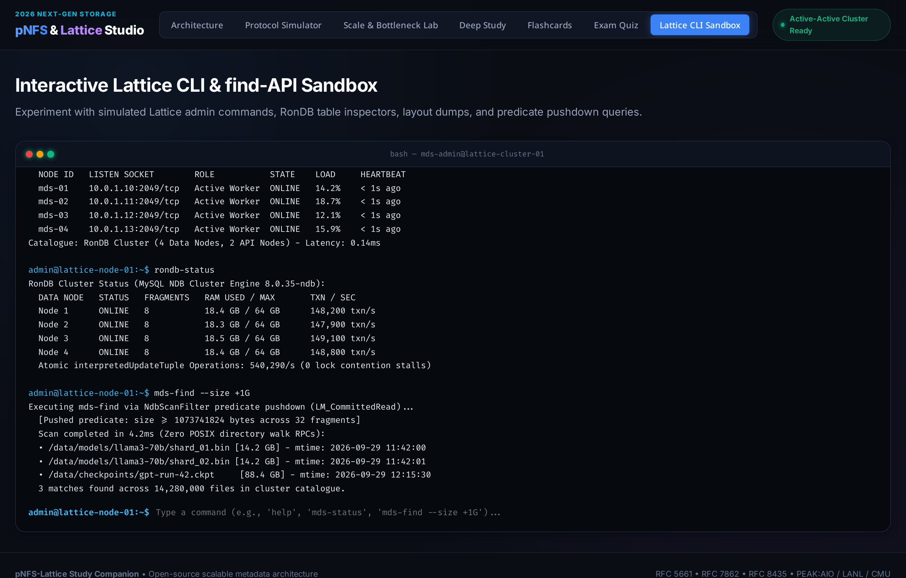
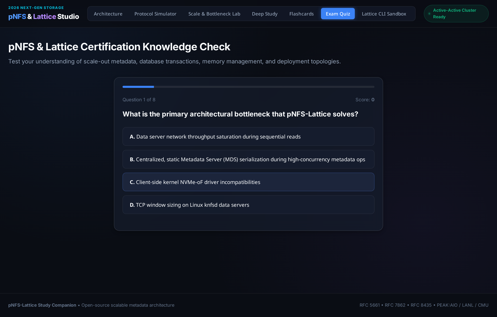

<div align="center">

# ⚡ pNFS & pNFS-Lattice Interactive Studio
### *Master Next-Generation Scale-Out Metadata, Flex Files (RFC 8435), and Distributed Storage for AI/HPC*

[](LICENSE)
[](https://datatracker.ietf.org/doc/html/rfc7862)
[](https://datatracker.ietf.org/doc/html/rfc8435)
[-success.svg)](server.py)
[](justfile)

<br/>

**A complete, interactive simulation suite and learning environment designed for storage engineers, AI infrastructure architects, and systems researchers to explore Parallel NFS and the cutting-edge pNFS-Lattice architecture.**

<br/>


*Active-Active User-Space Metadata Fleet, RonDB In-Memory Authority, and Commodity Linux Data Servers*

</div>

---

## 🚀 Quick Start in 10 Seconds

Everything is managed via [`just`](https://github.com/casey/just). Zero npm builds, zero pip wheels, zero external dependencies required to run the app.

```bash
# 1. Clone the repository
git clone https://github.com/killerclaffey/pnfs-lattice-study-app.git
cd pnfs-lattice-study-app

# 2. Launch the Web Studio (opens on http://localhost:8080)
just run

# 3. Or launch the terminal-based study companion (Flashcards, Quiz, & Reference)
just cli

# 4. Run automated test suite
just test
```

---

## 🌟 Interactive Feature Tour

### 1. Visual Architecture Explorer
Inspect the four decoupled planes of the pNFS-Lattice architecture:
* **Unmodified Linux Clients**: Kernel `nfs_layout_flexfiles` with seamless NFSv4 referrals (`fs_locations` / `NFS4ERR_MOVED`).
* **Lattice Core (MDS Fleet)**: Stateless active-active C daemons featuring the **Wave-2 Heap Scratch** memory model (~75% memory footprint reduction).
* **RonDB Metadata Catalogue**: Transactional single source of truth utilizing `interpretedUpdateTuple` for atomic parent-directory mutations without distributed lock manager (DLM) stalls.
* **Commodity Data Servers**: Unpatched Linux `knfsd` storage nodes serving parallel data stripes over 100GbE TCP or RoCE/InfiniBand RDMA.

---

### 2. Protocol Lifecycle Simulator
Experience how pNFS requests execute on the wire across all five protocol phases:

<div align="center">
  
  <p><em>Real-time protocol tracer showing Fused OPEN(CREATE) + LAYOUTGET wire compounds and direct DS data bypass.</em></p>
</div>

1. **Discovery & Referrals**: Client connects via `fs_locations` referral redirection.
2. **OPEN & Fused LAYOUTGET**: Atomic inode resolution in RonDB with instant Flex Files layout assignment.
3. **Direct DS Parallel I/O**: Compute clients stream directly to storage nodes—**MDS completely bypassed**.
4. **Commit & Return**: Size and timestamp updates committed in a single NDB transaction.
5. **Asynchronous Stripe GC**: Files are unlinked instantly from dirents while background workers drain the `gc_queue`.

---

### 3. Scale & Bottleneck Simulation Lab
Model AI training workloads (e.g. 10,000 GPU clients running PyTorch `DataLoader` or synchronized LLM checkpoint dumps):

<div align="center">
  
  <p><em>Interactive workload modeling: 3,500 clients hitting 16 active-active MDS daemons delivering 1.5M+ IOPS at 0.10ms latency.</em></p>
</div>

* **Compare Architectures**: Switch in real-time between **Traditional Monolithic NFS**, **Traditional pNFS** (single MDS bottleneck), and **pNFS-Lattice** (scale-out active-active).
* **Live Telemetry**: Observe metadata IOPS, aggregate storage bandwidth (GB/s), average latency (ms), and directory lock contention in real time.

---

### 4. Interactive Terminal Sandbox (`mds-admin` & Find-API)
Test administrative commands and explore database predicate pushdown directly in the browser:

<div align="center">
  
  <p><em>Built-in terminal emulator demonstrating parallel metadata search via NdbScanFilter predicate pushdown.</em></p>
</div>

* `mds-status`: Inspect active-active MDS daemons and heartbeat status.
* `rondb-status`: View fragment distribution, transaction rates (140,000+ txn/s per node), and atomic tuple counters.
* `ds-pool`: Inspect registered `knfsd` data servers and probed wire limits (`rtmax`/`wtmax`).
* `mds-find --size +1G`: Experience sub-millisecond metadata search without recursive POSIX directory walks.
* `mds-admin hpc enable <path>`: Enable `MDS_IFLAG_HPC_SHARED` for N-to-1 wide-stripe checkpointing.

---

### 5. Exam Knowledge Check & Flashcards
Solidify your storage architecture expertise with interactive study tools:

<div align="center">
  
  <p><em>Comprehensive certification quiz covering RFC 5661, RFC 8435, RonDB atomicity, and memory layouts.</em></p>
</div>

* **10 Spaced-Repetition Flashcards**: Interactive 3D flip cards covering protocols, concurrency, HPC striping, and kernel drivers.
* **8-Question Mastery Quiz**: Comprehensive questions with instant feedback and in-depth architectural explanations.

---

## 📂 Project Structure

```
pnfs-lattice-study-app/
├── justfile                     # Task runner configuration (run, dev, cli, test, info)
├── server.py                    # Zero-dependency Python 3 HTTP server & REST simulation API
├── cli.py                       # Rich terminal study companion & quiz runner
├── README.md                    # Project overview & visual documentation
├── docs/
│   ├── PNFS_AND_LATTICE_GUIDE.md# Exhaustive technical reference & architecture manual
│   └── assets/                  # High-resolution screenshots and marketing media
├── tests/
│   └── test_study_app.py        # Automated test suite
└── static/
    ├── index.html               # Main studio dashboard
    ├── style.css                # Polished dark-mode developer theme
    └── app.js                   # Interactive client-side engine & state machine
```

---

## 🛠️ Management Recipes (`just`)

| Recipe | Description |
|---|---|
| `just` | Lists all available management commands |
| `just run` | Starts the Web Study Studio on `http://localhost:8080` |
| `just run PORT=9000` | Starts the server on a custom port |
| `just cli` | Launches the interactive Terminal Study Companion |
| `just test` | Runs the automated unit tests (`unittest`) |
| `just info` | Prints an instant technical cheat sheet to your terminal |

---

## 📚 Technical Reference

For an exhaustive, master-level engineering breakdown of Parallel NFS, RonDB internal tuple structures, and the NetApp/PEAK:AIO integration, consult our complete guide:

👉 **[Read the Full Technical Architecture Guide (`docs/PNFS_AND_LATTICE_GUIDE.md`)](docs/PNFS_AND_LATTICE_GUIDE.md)**

---

## 📄 License

Distributed under the [MIT License](LICENSE). Built for the open-source systems engineering, AI storage, and HPC community.
